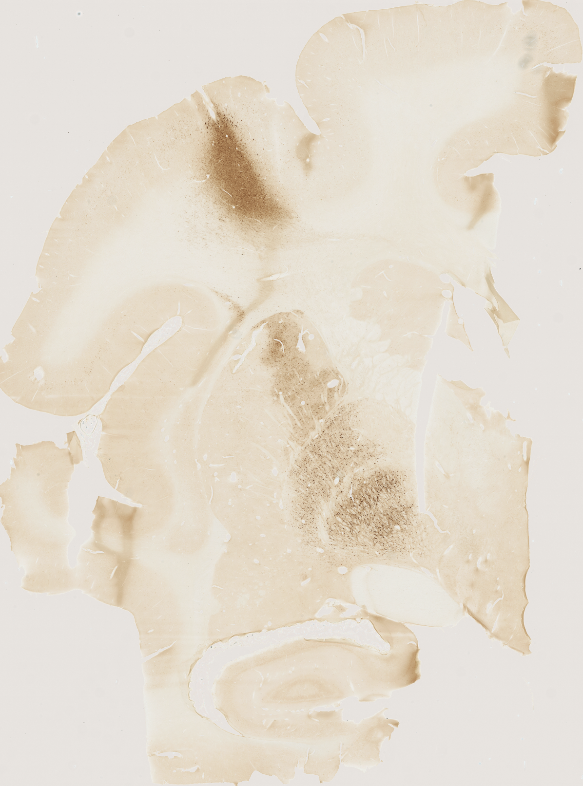
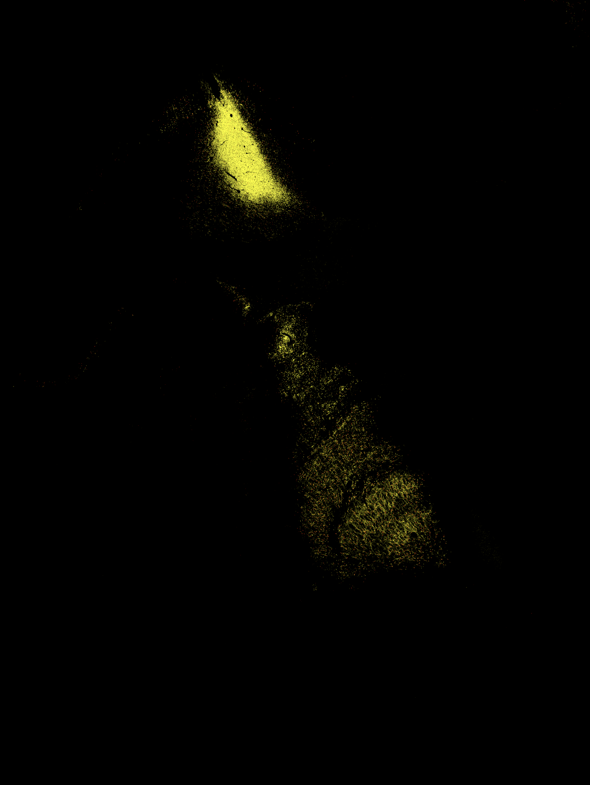
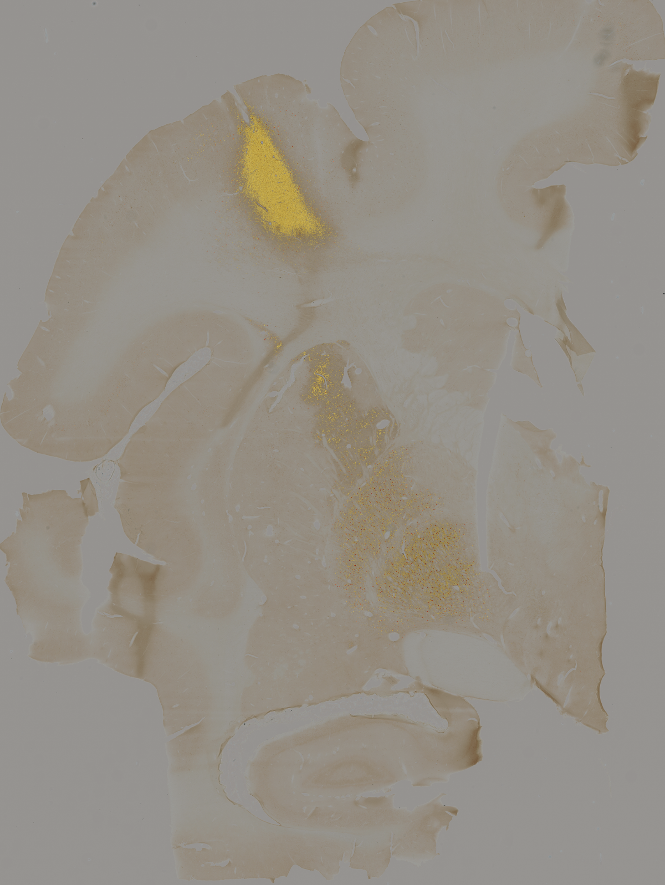

# UNet++ for Histology Image Segmentation

Automated segmentation of cell bodies and neuropil in immunoperoxidase-stained rhesus macaque brain tissue images using UNet++

This repository contains a trained UNet++ model that identifies **background**, **neuropil**, and **soma** in RGB histology images. It is intended to help researchers segment their own images without having to train a model from the beginning.

**What the colors mean:** black `#000000` = background (0), yellow `#EFF821` = neuropil (1), red `#FF0000` = soma (2). Both annotations and saved prediction images use these exact RGB colors. For fine-tuning the model, the different classess have to use those colors.

The model uses UNet++ with an EfficientNet-B0 encoder. You can **run it on new images** or **fine-tune it** with your own annotated images. It is intended for research; always check predictions before using them for measurements.

## What do the results look like?

**Before making the repository public:** put three real, representative images in `examples/`, named `original.png`, `prediction.png`, and `overlay.png`. The code below is already prepared. Remove the `<!--` and `-->` lines to show the pictures on GitHub.


| Original image | Model prediction |
|---|---|
|  |  |

**Overlay of prediction and original image**



## Part 1 — Analyze your own images (no training needed)

You only need to set up the software **once**. After that, you can analyze new images by copying them into a folder and running **one command**. These instructions use **Anaconda**, which provides Python and helps keep the libraries for this project separate from other projects. You do not need any previous machine-learning experience.

### Step 1. Download the repository

Click the green **Code** button at the top of this GitHub page, choose **Download ZIP**, and unzip it on your computer. Remember where you saved the extracted folder.

### Step 2. Install Anaconda (once)

1. Go to [Anaconda's official download page](https://www.anaconda.com/download).
2. Download **Anaconda Distribution** for your operating system (Windows or Mac) and follow its installation instructions. If you already have Anaconda or Miniconda, you can skip this step.
3. **Windows:** open **Anaconda Prompt** from the Start menu. **Mac:** open **Terminal**. You will type the commands below there.

You do **not** need to install Python separately: Anaconda includes it.

> **Why create an environment?** Think of a Conda environment as a separate workspace for this model. It keeps the software needed for this project from interfering with other programs on your computer.

### Step 3. Open the project folder in the terminal

Before running the setup commands, go to your extracted repository folder.

- **Mac:** type `cd` followed by a space, drag your project folder into Terminal, and press Enter.
- **Windows:** in File Explorer, open the project folder, click the address bar, type `cmd`, and press Enter. This opens a command prompt in that folder. Alternatively, use `cd` in Anaconda Prompt followed by the full path to your project folder.

**Windows note:** if you used File Explorer to open Command Prompt, the `conda` command may not be available there. In that case, use **Anaconda Prompt** instead and navigate into the project folder using `cd`.

### Step 4. Create the project's Conda environment (once)

In **Anaconda Prompt** (Windows) or **Terminal** (Mac), while inside the repository folder, run the following commands **one at a time**:

```bash
conda env create -f environment.yml
conda activate unetpp-histology
python -m pip install -r requirements.txt
```

The first command creates an environment with Python 3.11; the second switches into it; the third installs the model's libraries. This installation may take a while, depending on your internet connection and computer.

If the environment already exists because you previously set it up, **do not create it again**. Instead, run:

```bash
conda activate unetpp-histology
```

You should see `(unetpp-histology)` at the start of your command prompt. The environment needs to be activated each time you open a new terminal to use this model.

**GPU note:** These instructions are a straightforward starting point for CPU inference or supported Mac setups. For NVIDIA GPU acceleration or another specialized GPU configuration, use the installation selector at [PyTorch's official website](https://pytorch.org/get-started/locally/) to install a compatible version of PyTorch **after activating the Conda environment**, and before installing the rest of the requirements. PyTorch is installed with `pip` inside Conda because official new PyTorch releases no longer publish packages to the original PyTorch Conda channel.

### Step 5. Check that the software is ready (optional)

```bash
python -c "import torch; import segmentation_models_pytorch; print('Ready! PyTorch:', torch.__version__)"
```

If this prints `Ready!`, the key libraries have been imported successfully. This does **not** verify your checkpoint or the scientific accuracy of the model.

### Step 6. Put three things in the correct folders

1. **Your new images:** put RGB `.png` images in `data/raw/`. Keep the filenames simple (for example `image_01.png`). The current scripts accept PNG images only.
2. **The normalization reference:** save the **same PNG used during original training** as `reference/normalization_reference.png`.
3. **The trained model:** save the pretrained checkpoint as `models/best_foreground.pt`. (If the model is offered as a separate download, obtain it from the download link on this page.)

> **Repository owner:** add the real normalization reference and pretrained weights before asking someone else to follow these instructions. Neither is included in this template. If the weights are larger than GitHub's file limit, publish them in a Release and add the download link here.

### Step 7. Run the model

With `(unetpp-histology)` active in Anaconda Prompt / Terminal, from the project folder, run:

```bash
python scripts/analyze_images.py
```

That's it. This command first **normalizes** your images using `reference/normalization_reference.png` and then **segments** them using the trained model.

You will find the results in `outputs/inference/`:

| File | What it means |
|---|---|
| `image_01_pred_rgb.png` | Color-coded segmentation (black, yellow, red) |
| `image_01_overlay.png` | Segmentation blended with the normalized image |
| `image_01_pred_ids.png` | Pixel class numbers (0, 1, 2), useful for further analysis |

The normalized input images are saved in `data/images_norm/`. Your original images in `data/raw/` are not changed. **Important:** the overlay is displayed on the normalized image, not the untouched original.

If you encounter a memory error, use the lower-memory option:

```bash
python scripts/analyze_images.py --batch-size 1
```

Using a GPU will generally be faster, but CPU inference is also supported. Whole-slide images can require substantial memory.

### Next time you want to analyze more images

1. Open **Anaconda Prompt** (Windows) or **Terminal** (Mac).
2. Go back to the extracted project folder.
3. Run `conda activate unetpp-histology`.
4. Put new PNG images in `data/raw/`, then run `python scripts/analyze_images.py` again.

You don't have to reinstall Anaconda or recreate the environment each time. Results for files with the same names may be overwritten, so save any results you want to keep before reusing filenames.

### Want to run normalization or inference separately?

```bash
python scripts/normalize_images.py --input data/raw --reference reference/normalization_reference.png --output data/images_norm --save-qc
python scripts/run_inference.py --images data/images_norm --checkpoint models/best_foreground.pt --output outputs/inference
```

`--save-qc` makes quality-check images to help you inspect the region used for normalization.

## Part 2 — Fine-tune the model with your own annotated images

**Fine-tuning** means starting with our trained model, then adapting it to your images. It is useful if your images differ in staining, tissue preparation, or imaging conditions. You need images **and** matching manually annotated masks; the software cannot fine-tune from unlabeled images alone.

### Step 1. Prepare matching images and masks

Put your raw images in `data/raw/` and normalize them as described in Part 1. Put your **matching color annotation masks** in `data/labels_rgb/`. Each annotation must have exactly the same width, height, and filename as the corresponding image:

```text
data/raw/image_01.png
data/labels_rgb/image_01.png
```

**Color masks** should use black for background, yellow for neuropil, and red for soma, following the conventions of the supplied `mask_ids.py` converter. Check the converted masks visually; color variations or compression can produce incorrect labels. Never normalize your annotation masks.

### Step 2. Convert the masks into training labels

```bash
python scripts/mask_ids.py --input data/labels_rgb --output data/masks_ids
```

The resulting grayscale files must contain **only** the numbers 0, 1, and 2. If your existing masks already use these three integer values, you can put them directly in `data/masks_ids/` instead.

### Step 3. Decide which images will be used for training and validation

Create two plain text files:

- `data/train_ids.txt`: image names for training, **one per line without `.png`**
- `data/val_ids.txt`: image names for validation, **one per line without `.png`**

Example `data/train_ids.txt`:

```text
image_01
image_02
```

Example `data/val_ids.txt`:

```text
image_03
```

Do not reuse an image in both groups. If several images come from the same animal or tissue sample, keep related images together in the same group to avoid overly optimistic results. For final performance claims, hold out a separate test set that is never used for fine-tuning or model selection.

### Step 4. Normalize the images

If you have not already run Part 1, run:

```bash
python scripts/normalize_images.py --input data/raw --reference reference/normalization_reference.png --output data/images_norm
```

Use **the same normalization reference** that was used to train the original model.

### Step 5. Start fine-tuning

With the `unetpp-histology` Conda environment active, copy this command into Anaconda Prompt / Terminal as a **single line**:

```bash
python scripts/fine_tune.py --images data/images_norm --masks data/masks_ids --train-ids data/train_ids.txt --val-ids data/val_ids.txt --checkpoint models/best_foreground.pt --output outputs/finetune --epochs 20 --batch-size 4 --lr 1e-5
```

- `--epochs 20`: a starting number of training rounds, **not a guaranteed best setting**.
- `--batch-size 4`: images processed per training batch; reduce to 1 if your computer runs out of memory.
- `--lr 1e-5`: learning rate; controls how much the pretrained weights change.

A GPU is recommended for fine-tuning. Training on a CPU is possible but may be very slow. This is a **simplified fine-tuning example**, not an exact recreation of every setting in the original training notebook.

### Step 6. Use the newly fine-tuned model

The best checkpoint is saved as `outputs/finetune/best_finetuned.pt`. To segment your already-normalized images with it, run:

```bash
python scripts/run_inference.py --images data/images_norm --checkpoint outputs/finetune/best_finetuned.pt --output outputs/finetuned_predictions
```

The fine-tuning script also saves `last.pt` and `training_history.csv`, which records the training and validation statistics. Validation in this script is calculated over overlapping image patches; do not treat it as an independent full-slide test score.

## Original training notebook

The original training workflow is included as [`notebooks/train_from_scratch.ipynb`](notebooks/train_from_scratch.ipynb). Saved outputs and dataset-specific paths/IDs were removed before sharing. Researchers who want to run it must provide their own dataset paths and train/validation/test lists. The model architecture is **UNet++ with an EfficientNet-B0 encoder**, trained for three classes using 512 × 512 patches and a 256-pixel stride.

## Repository layout

```text
README.md                         Instructions you are reading
environment.yml                  Conda environment (Python 3.11)
requirements.txt                  Python libraries installed inside that environment
scripts/analyze_images.py         One-command normalization + inference
scripts/normalize_images.py       Image normalization
scripts/run_inference.py          Segment normalized images
scripts/mask_ids.py               Convert color annotations to class IDs
scripts/fine_tune.py              Adapt the pretrained model to new data
notebooks/train_from_scratch.ipynb Original notebook (cleaned for sharing)
models/best_foreground.pt          ADD your trained weights here
reference/normalization_reference.png ADD the training reference PNG here
examples/                         ADD real input, prediction, overlay PNGs here
data/raw/                          Put new images here (not tracked by Git)
data/labels_rgb/                   Put manual color annotations here (not tracked)
data/masks_ids/                    Converted annotations (not tracked)
data/images_norm/                  Normalized images (not tracked)
outputs/                           Results and new checkpoints (not tracked)
```

## Citation and license

The code is offered under the **MIT License** (see [`LICENSE`](LICENSE)), subject to the project owner confirming that the code may be distributed. You may use and modify the code under that license. **Please cite the project if you use it in research.** Add your publication or software citation here before release; a machine-readable template is available in [`CITATION.cff`](CITATION.cff).

Note: MIT requires keeping the copyright and license notice, **not** an academic citation. The owner must separately confirm permission to redistribute trained weights, the reference PNG, and example images, and state their licenses if different.

## Limitations

The model was developed for a particular image type and staining workflow. It may not generalize to other stains, preparations, imaging systems, or datasets without further testing. Inspect predictions carefully and validate against expert annotations before quantitative scientific use.

---

**Repository owner: before making this public**, complete [`PUBLISHING_CHECKLIST.md`](PUBLISHING_CHECKLIST.md). Fill in the weights download link, citation, and real example results, and test the commands with your real model.
